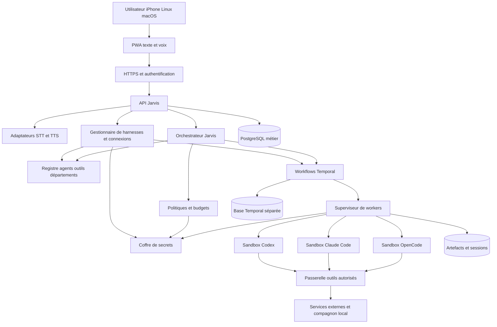
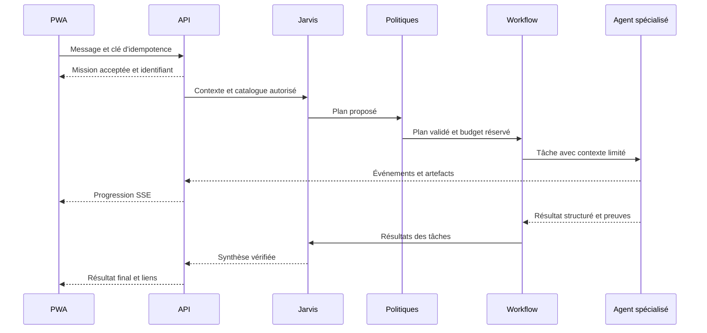

# Architecture du système

Le serveur sépare la prise de décision par les modèles de l’application des règles par du code. Jarvis propose un plan et choisit des spécialistes ; le noyau vérifie les droits, réserve les budgets, persiste les états et décide si une action peut effectivement être exécutée.

## Vue générale

Le plan de contrôle comprend l’API, les workflows, le registre, les politiques et les services de déploiement. Le plan d’exécution comprend les workers et leurs sandboxes. Un département est une catégorie métier, pas un service ou un conteneur permanent.

## Choix techniques proposés

| Élément | Choix | Motif |
| --- | --- | --- |
| Interface | React et TypeScript, build Vite, PWA | Base commune aux appareils cibles |
| API | Fastify et TypeScript, contrats JSON Schema | API explicite, validation des entrées et partage des types |
| Persistance métier | PostgreSQL | Transactions pour droits, budgets, état et audit |
| Orchestration durable | Temporal auto hébergé et SDK TypeScript | Attentes longues, reprises, délais et annulations |
| Exécution | Superviseur dédié et conteneurs isolés | Ressources et accès bornés par mission |
| Artefacts | Volume local via interface de stockage | Simplicité initiale ; migration possible vers stockage objet |
| Événements UI | SSE pour le flux serveur, HTTPS pour les commandes | Reconnexion et ordre des événements par mission |
| Audio | Adaptateurs STT et TTS | Choix indépendant des moteurs de coding |
| Déploiement initial | Docker Compose et images versionnées | Installation reproductible sur un serveur Linux |

Ces choix sont des recommandations d’architecture. Les versions exactes seront épinglées et testées au lot initial. Une recherche vectorielle PostgreSQL pourra compléter la recherche textuelle après mesure du besoin ; aucune base vectorielle indépendante n’est nécessaire au départ.

Temporal conserve l’historique des workflows et coordonne des activités. Les appels de modèle, commandes et accès réseau doivent être exécutés dans les activités, avec prise en compte de leurs reprises. [Workflows Temporal](https://docs.temporal.io/workflows), [activités Temporal](https://docs.temporal.io/activities).

## Limites des composants

L’API gère l’authentification, les conversations et les commandes. Elle accepte une mission puis répond avec son identifiant ; elle n’attend pas la fin d’un développement dans une requête HTTP.

L’orchestrateur génère un plan structuré, validé par schéma : tâches, dépendances, compétences, critères de réussite et bornes. Le noyau refuse les cycles, les références inconnues et les actions dépassant les autorisations. Pour une réponse simple, il n’instancie pas de département entier.

Temporal pilote l’état d’exécution. PostgreSQL métier fournit une projection pour la PWA et stocke les données métier ; les deux ne deviennent pas deux moteurs concurrents de scheduling. Une outbox transactionnelle démarre les workflows avec un identifiant déterministe. Les projections ignorent les doublons et un réconciliateur répare les écarts.

Le superviseur attribue une sandbox, un profil de compte et un workspace. Le modèle n’accède pas à l’API d’administration des conteneurs. L’adaptateur traduit les événements natifs du harness dans le format Jarvis. Les services externes sont accessibles par une passerelle qui vérifie les capacités autorisées.

Le gestionnaire de harnesses expose le catalogue, les opérations d’installation, la connexion et les profils d’exécution. Sa configuration et ses parcours de récupération sont déterministes et accessibles sans agent IA. Les installations passent par des workflows et le superviseur, avec recettes d’images versionnées. Le premier harness et les suivants appartiennent tous au déploiement Docker de Jarvis ; le plan d’exécution n’utilise jamais les CLI ou sessions du serveur hôte.

Le résolveur de profils choisit le profil explicite de l’agent, sinon le défaut de l’espace, y compris pour Jarvis. Il vérifie les politiques et capture la sélection dans le run avant tout appel à l’adaptateur. Le prompt décrit le travail ; il ne peut pas substituer un moteur au choix validé. Voir [la règle de résolution](04-harnesses.md#défaut-et-choix-par-agent).

## Séquence d’une mission

## Reprise et concurrence

Une activité peut être rejouée. Chaque action à effet de bord reçoit un `action_id` stable et un registre d’exécution. Le superviseur utilise `run_id` comme clé unique pour retrouver une exécution existante après perte de connexion. Un bail avec jeton de génération empêche deux workers de terminer le même run comme propriétaires actifs.

Pour un système externe sans idempotence, un timeout après envoi place l’action dans `outcome_unknown`. Jarvis vérifie l’état distant avant de recommencer ; il ne renvoie pas aveuglément un message ou un déploiement. La garantie visée est une reprise contrôlée, pas une promesse générale d’exécution exactement une fois.

Les agents de développement travaillent sur des checkouts isolés. L’intégration dans une branche commune est sérialisée ; un changement de commit de base impose de refaire les tests concernés. Les missions longues écrivent des checkpoints et des résumés, sans supposer que toute la mémoire de leur processus survivra.

## Modularité de départ

L’API reste un monolithe modulaire pour les conversations, registres, budgets et comptes. Les workers, Temporal, la base et le service de release sont des processus distincts. Cette séparation permet d’ajouter ultérieurement des machines de calcul sans imposer une architecture de dizaines de microservices.

Jarvis lui-même utilise un adaptateur de harness avec un profil d’orchestrateur : outils de planification et délégation uniquement, sans shell général. Une connexion directe à une API de modèle pourra devenir un autre adaptateur, mais n’est pas une dépendance obligatoire pour le texte.
