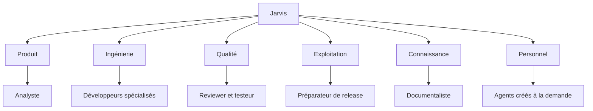

# Agents et départements

Un agent est une définition versionnée : rôle, instructions, contrats d’entrée et de sortie, outils permis, politique de modèles, mémoire et limites. Un run est une exécution de cette définition sur une tâche donnée. Créer un spécialiste n’entraîne pas un modèle et ne nécessite pas de déployer un service permanent.

## Organisation proposée

| Département | Agents initiaux | Responsabilité |
| --- | --- | --- |
| Direction | Jarvis orchestrateur | Comprendre, planifier, distribuer et restituer |
| Produit | Analyste fonctionnel, concepteur UX | Transformer un besoin en critères vérifiables |
| Ingénierie | Architecte, développeur, intégrateur | Concevoir et réaliser les changements |
| Qualité | Reviewer, testeur, évaluateur | Vérifier le code, le comportement et les performances |
| Exploitation | Analyste incidents, préparateur de release | Diagnostiquer et préparer le déploiement |
| Connaissance | Documentaliste, chercheur | Rechercher, synthétiser et gérer les sources |
| Personnel | Spécialistes créés à la demande | Tâches privées autorisées par le propriétaire |

Les rôles de départ sont des profils, activés selon la mission. Une petite correction peut demander un développeur et un reviewer ; une nouvelle intégration peut aussi mobiliser produit, architecture et qualité.

Un responsable de département est facultatif. Au départ, Jarvis appelle directement les profils spécialisés. Un niveau hiérarchique supplémentaire n’est ajouté que s’il réduit réellement la complexité de coordination.

## Création autonome

1. Rechercher une compétence existante dans le catalogue ; privilégier la réutilisation ou une nouvelle version.
2. Produire un manifeste, une justification et au moins trois cas d’évaluation, dont un hors périmètre.
3. Valider le schéma, les références d’outils, les restrictions du département et les contrats de sortie.
4. Exécuter les cas dans une sandbox avec données de démonstration.
5. Activer automatiquement si aucun nouveau droit ni outil n’est ajouté et si les évaluations passent.
6. Sinon, enregistrer un brouillon et demander le droit manquant ou ouvrir un changement logiciel.

Le cycle est `draft → evaluating → active → deprecated → archived`. Un échec d’évaluation revient à `draft` avec diagnostics. Une version active reste immuable ; les runs conservent son identifiant exact.

Un nouvel agent ne peut obtenir davantage de droits que l’intersection des droits du propriétaire, du département, du demandeur et de la mission. Il ne peut modifier cette règle en changeant ses instructions. Les nouveaux départements suivent le même mécanisme de catalogue ; la création d’une catégorie n’octroie aucun accès.

Le fichier [agent-developer.json](examples/agent-developer.json) montre un profil validable par [agent.schema.json](examples/agent.schema.json). Le schéma valide la forme ; le noyau valide les droits effectifs, les identifiants existants et la compatibilité du harness.

## Délégation

Chaque tâche contient un objectif, ses entrées, ses dépendances, les livrables attendus et un budget. Un spécialiste peut demander une sous-tâche via `agents.delegate`. Le noyau l’enregistre avant de lancer un autre agent. Les sous-agents natifs des harnesses sont désactivés par défaut ou comptabilisés explicitement dans le même arbre ; ils ne doivent pas créer une deuxième orchestration invisible.

Valeurs initiales proposées : profondeur de délégation maximale 3, 12 sous-tâches par mission, 2 workers lourds simultanés, 2 reprises pour une erreur transitoire et 2 cycles de correction après review. Le propriétaire pourra les modifier ; ce ne sont pas des limites fournisseurs.

Les enfants consomment une réservation du budget du parent. Le budget comprend durée, concurrence et unités disponibles : tokens lorsque mesurables, coût API estimé, durée et tours pour un abonnement sans coût marginal exposé. Un coût inconnu reste inconnu ; l’interface ne l’affiche pas à zéro. Une limite atteinte suspend la tâche avec un résultat partiel utile.

## Résultat attendu

Chaque agent rend une structure avec `status`, `summary`, `artifact_ids`, `evidence`, `unresolved_questions` et `suggested_next_actions`. Le statut de réussite est validé avec les sorties attendues ; une phrase « terminé » ne suffit pas à faire réussir un build.

Le reviewer reçoit les critères, le diff exact et les rapports des outils dans une session distincte. Il n’hérite pas de la conversation persuasive du développeur. Un autre modèle ou harness peut améliorer la diversité du regard, mais ne remplace pas les tests exécutés.

## Mémoire

| Portée | Contenu | Règle |
| --- | --- | --- |
| Conversation | Messages, résumés, références d’artefacts | Accessible aux participants autorisés |
| Mission | Plan, décisions et checkpoints | Partagée uniquement avec les agents affectés |
| Projet | Conventions, architecture et documentation | Indexée avec provenance et version |
| Personnel | Préférences explicites et informations approuvées | Consultable, rectifiable et supprimable |
| Agent | Retours d’évaluation et procédures | Promotion versionnée après évaluation |

Les documents récupérés sont des données, pas des instructions de sécurité. Toute mémoire conserve sa source, son périmètre, sa date et, si nécessaire, son expiration. Une suggestion déduite par un agent reste distincte d’un fait confirmé. La suppression couvre également les index et résumés dérivés ; la rétention des sauvegardes est expliquée dans les réglages.

Une recherche textuelle avec filtres d’accès suffit au premier lot. La recherche sémantique pourra compléter ce mécanisme sans jamais contourner le filtrage par espace et projet.
