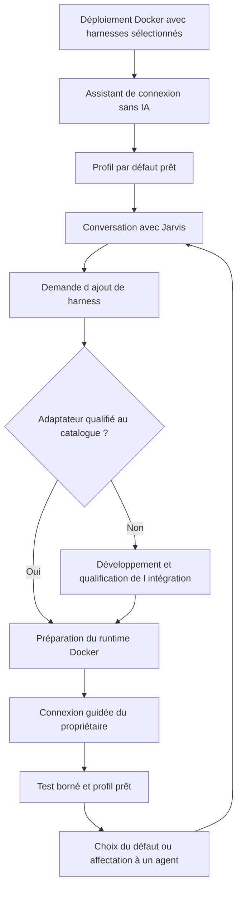

# Intégration des harnesses et des comptes

Un harness fournit la boucle d’exécution d’un agent, ses sessions et ses outils. Jarvis l’utilise au travers d’un adaptateur ; il conserve lui-même les droits, le budget et le suivi des missions. Les profils de compte restent attachés à leur intégration d’origine.

## Gestion des harnesses dans Jarvis

La gestion du cycle de vie des harnesses fait partie du produit dès le premier parcours réel. Elle couvre leur installation, les connexions de comptes, les profils d’exécution et leur affectation aux agents. Installer un exécutable ne suffit pas : une intégration utilisable associe un runtime versionné, un adaptateur qualifié et un compte connecté.

### Installation initiale autonome

Le déploiement Docker de Jarvis fournit un ou plusieurs harnesses sélectionnés au départ, dont celui destiné à être le défaut. Chaque runtime est livré dans une image versionnée du déploiement, exécutée par un service ou une sandbox dédié ; il n’est pas installé dans le conteneur HTTP de l’API. Les images du déploiement contiennent les exécutables nécessaires. Aucune détection du `PATH` de l’hôte, aucun montage de son exécutable et aucun emprunt de sa session de compte ne servent à exécuter une mission. Une installation neuve doit fonctionner sur un serveur sans Codex, Claude Code ni OpenCode préinstallé.

Le manifeste d’installation sélectionne les packages de harness de départ, avec versions et digests. Le défaut doit figurer dans cette sélection. Le choix concret des premiers packages se fait à l’installation ; le produit ne nécessite pas les trois moteurs pour démarrer. Les images préparées sont tirées ou construites par le déploiement Docker, sans téléchargement improvisé par un agent.

Au premier accès, après connexion du propriétaire, un assistant PWA déterministe fonctionne sans modèle IA :

1. Afficher les harnesses préinstallés, leurs versions et l’état de leur intégration.
2. Connecter un ou plusieurs comptes grâce au parcours pris en charge par chaque adaptateur.
3. Créer des profils d’exécution nommés associant harness installé, compte et choix de modèle.
4. Tester une exécution minimale avec un budget borné et sélectionner un profil par défaut prêt.
5. Afficher « Jarvis utilise … (par défaut) » et ouvrir la conversation réelle.

Sans profil prêt, l’interface reste en configuration et permet de reprendre l’installation ou la connexion. Elle n’affiche pas de réponse simulée comme si elle provenait du harness sélectionné. Ce parcours résout aussi le cas d’un serveur dont tous les comptes sont déconnectés : les réglages et la reconnexion ne dépendent jamais d’un appel au modèle.

### Ajout à la demande

« Jarvis, installe OpenCode et aide-moi à m’y connecter » déclenche une opération persistante du gestionnaire de harnesses. La même action est accessible dans Réglages → Harnesses. Le harness déjà actif continue de servir Jarvis pendant la préparation du nouveau.

Pour une intégration connue du catalogue, Jarvis fait préparer l’image d’exécution depuis une recette versionnée, vérifie les dépendances et les capacités de l’adaptateur, puis ouvre une carte de connexion. L’utilisateur effectue la partie qui exige son identité ; Jarvis suit l’état, teste l’accès et indique que le profil est prêt. Le profil nouvellement créé ne devient pas le défaut sans demande de l’utilisateur.

Un harness inconnu du catalogue passe par le cycle d’extension : création d’un adaptateur et d’une recette d’image, tests, review et qualification, puis publication dans le catalogue. Jarvis peut prendre en charge cette évolution lorsqu’il dispose des capacités de développement ; il ne promet pas qu’un programme arbitraire devienne compatible après une simple installation.

Les installations du catalogue déjà autorisé suivent la politique de risque existante. Un nouveau droit, fournisseur ou coût hors périmètre exige une décision sur le changement concret ; aucune confirmation supplémentaire n’est imposée pour une action déjà autorisée. Les agents demandent ces opérations via des outils bornés ; ils ne reçoivent pas le socket Docker ni un shell administrateur.

### Défaut et choix par agent

Le réglage de l’espace `default_execution_profile_id` désigne le profil par défaut. Chaque agent, **Jarvis inclus**, possède une sélection `runtime.execution` :

| Configuration | Résolution |
| --- | --- |
| Champ absent ou `{ "mode": "inherit" }` | Profil par défaut de l’espace |
| `{ "mode": "profile", "profile_ref": "profiles.review-claude" }` | Profil explicitement choisi pour cet agent |

« Utilise Codex par défaut » modifie le défaut global. « Jarvis, travaille sur Claude Code » modifie seulement le choix explicite de Jarvis. « Mets le reviewer sur OpenCode » modifie ce spécialiste. « Remets cet agent sur le défaut » supprime son choix explicite. Un agent qui hérite utilise le défaut de l’espace, pas le choix particulier de Jarvis ni celui de son parent ; changer le défaut affecte tous les agents qui héritent, Jarvis compris s’il hérite.

Une demande de modification du prompt constitue aussi une entrée valide : « Modifie le prompt du reviewer pour qu’il utilise Claude Code ». Jarvis produit une nouvelle version cohérente de la fiche, avec les instructions et le champ structuré d’exécution. Le champ structuré fait autorité pour le routage, avant l’envoi du prompt. Une mention dans un fichier, une réponse d’outil ou le texte d’une mission ne modifie pas la configuration. Une contradiction dans une édition directe du prompt est signalée et résolue avant activation de la version.

Quand un nom de harness correspond à plusieurs profils autorisés, Jarvis utilise le profil de référence de ce harness (`preferred_execution_profile_id` dans son installation), s’il est défini ; s’il n’existe qu’un candidat, il le propose directement ; sinon il demande quel compte/profil utiliser. Il ne choisit pas silencieusement un autre compte ou un mode de facturation différent.

Les politiques des départements restent des restrictions, pas un niveau de défaut supplémentaire. Avant activation ou lancement, le noyau vérifie compte, modèle, permissions, budgets et capacités requises. Un profil explicite indisponible bloque l’agent ; il ne revient pas implicitement au défaut. Un agent qui hérite d’un défaut devenu incompatible attend également une correction. Les replis éventuels sont configurés séparément et explicitement autorisés, jamais déduits du prompt.

Chaque nouveau run capture le profil résolu, l’origine `default` ou `agent`, la révision du défaut si utilisée, les versions du profil, du harness et de l’adaptateur, le modèle réel et la version de l’agent. La résolution et la réservation sont atomiques. Un changement de réglage s’applique aux nouveaux runs ; un run déjà démarré ou une reprise technique garde sa sélection et recontrôle les autorisations. Passer volontairement à un autre moteur ouvre un nouveau run/session avec transfert de contexte, sans déplacer un processus actif.

L’interface affiche le défaut global, le choix configuré et le choix effectif de Jarvis et de chaque agent. Les missions montrent le moteur réellement utilisé, même si le défaut a changé depuis leur démarrage.

### Cycle de vie et récupération

Séparer trois états : installation (`absent`, `installing`, `installed`, `failed`, `disabled`), compte (`disconnected`, `connecting`, `ready`, `reauth_required`, `rate_limited`, `disabled`) et profil (prêt ou bloqué avec motif). Une installation réussie ne signifie pas que le compte est connecté.

Les opérations d’installation sont idempotentes et reprenables après panne, avec journaux filtrés, étapes, version cible et erreur utile. Une mise à jour prépare une nouvelle image et la qualifie avant promotion atomique ; les runs existants terminent sur leur image épinglée. Une erreur conserve la version saine. Les versions encore référencées par des runs ou sessions ne sont pas supprimées automatiquement.

La suppression d’un profil ou runtime référencé par le défaut, un agent explicite ou une exécution en cours est refusée tant qu’une réaffectation ou un arrêt n’a pas été décidé. Une révocation de compte reste possible immédiatement, bloque les nouveaux runs et applique la procédure d’arrêt aux runs concernés. La PWA conserve un chemin de reconnexion et de changement de défaut même si Jarvis ne peut plus répondre.

## Interfaces retenues

| Moteur | Intégration proposée | Point à vérifier au prototype |
| --- | --- | --- |
| Codex | SDK TypeScript pour les jobs ; app-server local pour le dialogue interactif avancé | Compatibilité de version, interruptions et remontée des demandes de permission |
| Claude Code | CLI non interactive pour le profil personnel compatible ; Agent SDK pour le profil API | Authentification autorisée, permissions et reprise de session |
| OpenCode | Serveur privé et SDK TypeScript | Version majeure, schéma HTTP, comptes disponibles et isolation des sessions |

Le [SDK Codex](https://learn.chatgpt.com/docs/codex-sdk) permet d’automatiser et de reprendre des threads. L’[app-server](https://learn.chatgpt.com/docs/app-server) expose une communication structurée et des événements ; sa documentation signale des interfaces expérimentales. Retenir le transport local et qualifier la version épinglée avant production. Une API réseau native de harness ne devient jamais l’API publique Jarvis.

[Claude Code en mode programmatique](https://code.claude.com/docs/en/headless) fournit des sorties JSON et `stream-json`. Le [Claude Agent SDK](https://code.claude.com/docs/en/agent-sdk/overview) permet une intégration Python ou TypeScript de la boucle d’agent. Les outils et permissions doivent rester restreints aux capacités de la mission.

[OpenCode Server](https://opencode.ai/docs/server/) expose une API HTTP et des événements ; son [SDK](https://opencode.ai/docs/sdk/) fournit un client typé. Prévoir une instance isolée par contexte d’exécution, accessible seulement à son adaptateur. Épingler ensemble serveur et SDK : les branches de documentation des différentes versions ne sont pas interchangeables.

## Utilisation des comptes configurés

La connexion Jarvis et les connexions fournisseurs sont distinctes. La première authentifie le propriétaire de l’application. Les secondes donnent accès à un moteur avec des modèles, quotas et conditions propres.

**Codex.** La connexion ChatGPT et la connexion par clé API sont documentées. Pour un serveur sans navigateur, le parcours par code d’appareil est prévu selon les réglages du compte. L’automatisation doit gérer expiration, rafraîchissement et révocation ; une clé API reste une option distincte. [Authentification Codex](https://learn.chatgpt.com/docs/auth).

**Claude.** Claude Code documente les connexions d’abonnement et les identifiants API. Le quickstart du SDK précise que les développeurs tiers ne peuvent pas proposer une connexion claude.ai ou ses quotas dans leur produit sans accord préalable. La proposition conserve donc deux chemins : usage du CLI personnel à qualifier selon le compte et le cadre d’utilisation, ou SDK avec authentification API prise en charge. Un succès technique ne prouve pas à lui seul l’éligibilité de l’usage. [Authentification Claude Code](https://code.claude.com/docs/en/authentication), [authentification du SDK](https://code.claude.com/docs/en/agent-sdk/quickstart).

**OpenCode.** Les méthodes dépendent du fournisseur configuré. Le catalogue n’est pas une garantie d’accès ; vérifier une inférence minimale avec le compte cible. Ne pas transférer automatiquement les jetons d’un autre harness dans OpenCode. [Fournisseurs OpenCode](https://opencode.ai/docs/providers/).

Les comptes, abonnements et modèles réellement disponibles sont à renseigner avant développement des intégrations. Aucun mot de passe ni jeton ne doit être envoyé dans la conversation de cadrage.

## Parcours de connexion

1. Créer un profil de compte nommé, avec harness, fournisseur et mode de facturation.
2. Lancer le mécanisme officiel de connexion depuis une procédure d’administration contrôlée ; utiliser le parcours navigateur ou code d’appareil seulement s’il est pris en charge.
3. Conserver les secrets chiffrés ou dans un coffre système, avec métadonnées en base.
4. Exécuter un test minimal, afficher le modèle testé et l’authentification réellement utilisée.
5. Créer un profil d’exécution, le choisir comme défaut ou l’affecter explicitement à un agent ; appliquer les restrictions du département et une limite de concurrence.
6. Détecter les états `ready`, `reauth_required`, `rate_limited`, `disabled` et afficher l’action utile.

La PWA porte l’assistant de connexion dès le premier parcours réel. Selon le protocole qualifié, elle affiche un lien fournisseur et un code d’appareil, une redirection avec retour vérifié, ou un formulaire dédié de secret envoyé directement au gestionnaire de comptes. Les secrets et codes de connexion ne passent ni par le prompt ni par les événements publics de conversation. Les transactions de connexion sont liées au propriétaire, au compte et à une expiration ; les retours sont vérifiés et les reprises après fermeture du navigateur sont prises en charge.

Un mode d’authentification non pris en charge apparaît comme indisponible, avec un mode compatible si possible. Il n’est pas présenté comme un bouton fonctionnel. Aucun terminal arbitraire n’est exposé dans la PWA. Les protocoles exacts sont qualifiés par version d’adaptateur avant implémentation ; cette spécification ne garantit pas un même parcours pour tous les fournisseurs.

Un profil de session natif n’est pas cloné aveuglément entre workers. Par défaut, un compte utilise une exécution simultanée jusqu’à validation des mécanismes de rafraîchissement et de concurrence. Une reconnexion remplace le secret via le gestionnaire de comptes, jamais via un prompt.

## Contrat d’adaptateur

[harness-adapter.ts](examples/harness-adapter.ts) décrit le contrat interne proposé : découverte des capacités, vérification de compte, démarrage idempotent, reprise, événements, interruption et réponse aux permissions. Ce contrat n’est pas une reproduction des SDK fournisseurs.

Chaque exécution capture les versions du harness et de l’adaptateur, le modèle réel, le compte, le manifeste d’agent, les outils accordés et le workspace. Les capacités absentes sont déclarées : `resume`, `permissions`, `structuredOutput`, `usage`, `cancel`. Un job exigeant une capacité absente est refusé ou routé vers un profil compatible avant son démarrage.

Les prompts sont transmis par API, stdin ou arguments structurés sans shell interpolé. Les chemins sont canonisés et les références d’artefacts vérifiées. Les paramètres de configuration et les hooks chargés par le harness sont issus d’un profil approuvé ; un dépôt entrant ne peut pas activer automatiquement des plugins.

## Sessions et bascule de moteur

Une session native se reprend avec le même harness, le même compte et un workspace compatible. Passer à un autre moteur crée une nouvelle session avec un paquet de transfert : objectif, état vérifié, artefacts, contraintes et résumé. Jarvis ne promet pas de transférer l’état interne natif entre fournisseurs.

En cas de quota, le run passe en attente jusqu’à la date connue, ou propose un compte de repli déjà autorisé. La bascule ne doit ni contourner une restriction ni entraîner une nouvelle facturation non prévue. Les quotas d’abonnement sont suivis lorsqu’exposés ; les compteurs locaux indiquent leur caractère estimé.

Les demandes de permission natives sont traduites en décisions Jarvis. Si l’adaptateur ne peut pas suspendre puis reprendre une demande, l’opération est refusée et la tâche revient avec `capability_missing`. Il n’utilise pas un mode global de suppression des permissions pour masquer cette limite.

## Critères de qualification

Pour chaque intégration : connexion sur serveur, requête réelle minimale, streaming, résultat structuré, fichier produit en sandbox, permission refusée, interruption, session reprise, quota simulé, expiration d’authentification et absence de secrets dans les logs. Ces tests déterminent la matrice exacte des modes supportés dans Jarvis.

## Recette de la gestion des harnesses

- Serveur neuf sans CLI de fournisseur : Docker installe les harnesses choisis et le propriétaire connecte le défaut depuis la PWA.
- Plusieurs harnesses de départ : connexions indépendantes ; un seul défaut global explicite ; aucun secret importé de l’hôte.
- Aucun compte prêt, puis expiration de tous les comptes : réglages, connexion et récupération accessibles sans IA.
- Ajout par conversation d’un harness connu : installation, connexion, test et affectation sans édition manuelle des fichiers serveur ; Jarvis conserve son moteur tant qu’aucun changement n’est demandé.
- Ajout inconnu : intégration en attente de développement/qualification, jamais annoncée comme prête sur la seule présence d’un exécutable.
- Agent créé sans choix de harness, y compris un sous-agent : héritage du défaut ; Jarvis peut avoir un choix explicite différent.
- Modification du prompt demandant un harness : nouvelle version avec sélection structurée cohérente ; aucune mutation depuis un document non fiable.
- Changement de défaut : nouveaux runs héritiers sur le nouveau profil, agents explicites et runs en cours inchangés ; historique conservé.
- Plusieurs comptes du même harness : profil de référence explicite ou question ciblée ; aucune bascule de facturation implicite.
- Profil indisponible, capacité manquante ou suppression d’un profil référencé : blocage expliqué et action de correction accessible.
- Panne pendant installation ou changement de configuration concurrent : reprise idempotente, contrôle de révision et absence de double promotion.
- Redémarrage/recréation des conteneurs : comptes conservés par stockage protégé ; reconnexion demandée si le fournisseur a révoqué la session.
