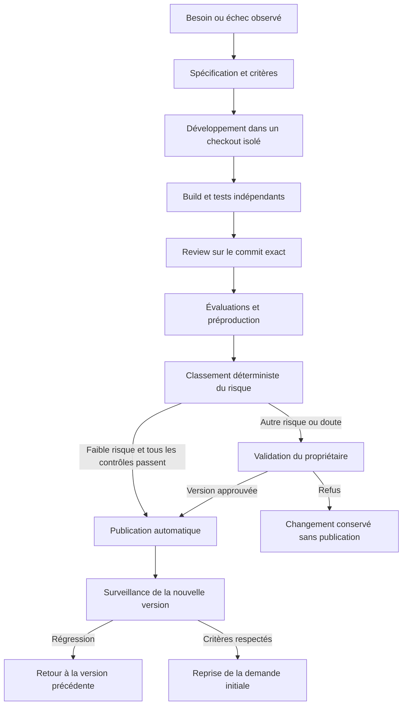

# Développement autonome et publication des évolutions

Jarvis peut améliorer ses agents, ajouter des outils et modifier son application. Chaque évolution produit une version identifiable, des preuves de validation et un mécanisme de retour arrière. Le propriétaire a choisi le déploiement autonome pour les changements à faible risque et une validation humaine pour les autres.

## Trois formes d’évolution

| Type | Exemple | Livraison |
| --- | --- | --- |
| Configuration | Nouveau spécialiste ou amélioration d’un prompt | Nouvelle version de manifeste évaluée |
| Extension | Lecteur de CSV, générateur de rapport, connecteur | Paquet versionné, exécuté hors du noyau |
| Application | Nouvel écran, API ou comportement du noyau | Release applicative testée et déployée |

Une extension possède un manifeste, des contrats d’entrée et sortie, des capacités, une version de compatibilité et des évaluations. Son code serveur s’exécute dans un worker séparé. Les cartes UI déclaratives utilisent des composants approuvés ; du JavaScript généré n’est pas injecté directement dans l’interface principale.

## Chaîne de réalisation

Un échec de test revient au développeur avec diagnostic. Après deux cycles de correction sans succès, la mission est suspendue avec le diff et les résultats ; elle ne multiplie pas indéfiniment les agents.

## Politique de faible risque

Un changement est publiable automatiquement seulement si **toutes** les conditions sont vraies :

- Le diff reste dans un périmètre autorisé par le propriétaire : manifestes sans nouveaux droits, documentation, extensions déjà isolées, ou composants UI explicitement autorisés.
- Aucun élargissement des capacités, réseau, secrets, dépendances d’exécution, hooks ou commandes de build.
- Aucune migration persistante, changement de contrat incompatible ou modification de l’authentification, des budgets, du moteur de politiques, du sandboxing ou du déploiement.
- Le changement a une taille bornée et une surface connue ; valeurs initiales proposées de 10 fichiers et 300 lignes modifiées, sans considérer ces seuils comme une preuve de sûreté.
- Les tests obligatoires, évaluations et review indépendante portent sur le même commit et passent.
- La préproduction est saine et le retour arrière a été vérifié pour cette catégorie de changement.
- Une seule release automatique est en cours ; le budget et la fenêtre de publication autorisée sont respectés.

Le classement résulte de règles sur le diff, les manifestes, les dépendances et les rapports. Les agents peuvent signaler des risques supplémentaires, jamais diminuer le classement imposé par les règles. Toute situation inconnue bascule vers la validation humaine. Une interface UI peut être sensible : les écrans de connexion, paiement ou permissions restent hors de l’autorisation automatique.

| Classe | Exemples | Décision |
| --- | --- | --- |
| Faible | Prompt évalué sans droits supplémentaires, correction dans une extension isolée | Publication automatique après contrôles |
| Intermédiaire | Nouvelle intégration, nouveau domaine réseau, dépendance ou évolution d’API | Validation humaine sur artefact précis |
| Élevée | Migration, accès aux secrets, permissions, infrastructure ou noyau de contrôle | Validation humaine et procédure dédiée |

La première mise en service du pipeline et tout changement de cette politique sont validés par le propriétaire. Cette frontière réalise son choix d’autonomie sans laisser Jarvis élargir lui-même ses pouvoirs.

## Indépendance des vérifications

Le développeur ne dispose pas du jeton de publication. Le reviewer peut produire un rapport, mais la réussite des tests provient du runner de confiance. Les tests de base, la politique de release et les scripts de validation sont exécutés depuis une version approuvée distincte ; modifier leur copie dans le changement ne suffit pas à assouplir le contrôle.

Un agent peut ajouter des tests de régression dans son patch. Le runner compare également le résultat à une suite de référence, à des scénarios de permissions et aux critères fonctionnels écrits avant développement. Les outputs des agents restent non fiables jusqu’à validation de leur forme et de leurs références.

Le service de release vérifie commit, digest de l’artefact, version de politique et rapports. Une approbation devient invalide si l’un d’eux change. Une approbation humaine n’autorise pas automatiquement à ignorer les tests requis.

## Publication et retour arrière

Construire une image immuable depuis le commit validé, puis la déployer en préproduction avec données synthétiques. Après décision de publication, démarrer la nouvelle version à côté de l’ancienne lorsque la capacité du serveur le permet ; sinon prévoir une fenêtre contrôlée. Vérifier les checks de disponibilité avant bascule.

Au MVP, surveiller pendant 15 minutes les erreurs, la connexion utilisateur, l’ouverture d’une conversation, l’exécution d’un agent de contrôle et l’activation de l’extension. Un échec des sondes provoque le retour à l’image et aux manifestes précédents. Ce délai est une valeur initiale ajustable, pas une garantie statistique.

Les workflows actifs restent attachés à leur version de worker. L’ancienne version termine les missions engagées ou transfère un checkpoint compatible ; on ne tue pas indistinctement les tâches en cours pendant une release.

Les migrations suivent une stratégie d’extension puis contraction, avec sauvegarde et exercice de restauration. Restaurer l’image ne restaure pas la base. Une migration incompatible exige une procédure spécifique validée humainement ; elle est exclue du déploiement automatique.

## Déclencheurs et apprentissage

Une amélioration peut venir d’une demande explicite, d’un échec récurrent ou d’un indicateur de qualité. Jarvis crée alors une proposition avec bénéfice attendu, coût maximal et mesure de réussite. Les travaux proactifs consomment un budget distinct configuré par le propriétaire ; par défaut, la détection peut proposer sans démarrer un développement non sollicité.

Les performances d’un agent sont comparées avant et après sur des cas conservés : réussite, erreurs, durée et consommation. Une modification de prompt qui dégrade les cas existants ne devient pas automatiquement la nouvelle version. L’auto amélioration n’est donc pas supposée monotone ; elle est mesurée et réversible.

## Première tranche livrée

Le [lot outils de développement](11-outils-developpement.md) livre la copie isolée, le patch, les tests unitaires de référence et la revue indépendante. La publication en PR, la préproduction éphémère et un premier classement déterministe sont livrés dans les lots 17 et 18. Le lot 19 complète les releases de documentation/interface et le retour arrière. Le backend et les migrations nécessitent encore une procédure opérateur. Une revue favorable seule ne déclenche aucune release.
