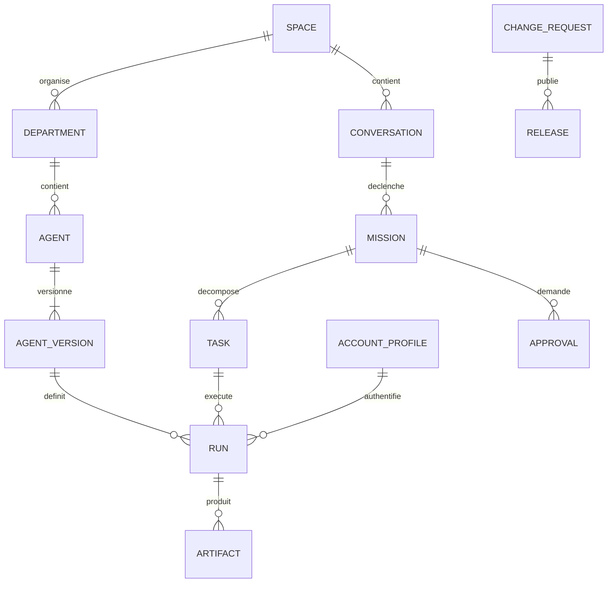

# Modèle de données et contrats API

PostgreSQL métier stocke les conversations, définitions et résultats. Temporal possède l’état d’exécution des workflows. L’API expose des projections cohérentes avec leur historique ; elle n’exécute pas directement les commandes des agents.

## Entités principales

| Entité | Champs et contraintes essentiels |
| --- | --- |
| `users`, `spaces`, `memberships` | Identité, propriétaire et appartenance ; toutes les données sont rattachées à un espace |
| `devices`, `sessions` | Appareil, clé publique éventuelle, session expirante et révocation |
| `conversations`, `messages` | Auteur, contenu, pièces jointes et `client_message_id` unique par conversation |
| `departments` | Domaine, politique, budget et état actif |
| `agent_definitions`, `agent_versions` | Identité logique, version immuable, manifeste, hash et état d’évaluation |
| `tool_versions` | Contrats, capacités, artefact exécutable, version et permissions |
| `account_profiles` | Harness, fournisseur, référence de secret, mode de facturation et état |
| `missions`, `tasks` | Objectif, DAG de dépendances, versions de politiques et critères de réussite |
| `runs` | Tentative, agent, compte, modèle réel, session native, workspace et checkpoint |
| `events` | `event_id`, `mission_id`, séquence, type, version de schéma et charge utile filtrée |
| `artifacts` | Objet stocké, taille, type MIME, hash, propriétaire et durée de conservation |
| `approvals` | Action, hash du contenu approuvé, identité, expiration et décision |
| `capability_grants` | Sujet, action, ressource, contraintes, mission et expiration |
| `budget_reservations`, `usage_entries` | Réservations atomiques, consommation mesurée ou estimée, rapprochement |
| `action_ledger` | Action idempotente, état, identifiant distant et preuve de résultat |
| `change_requests`, `releases` | Commit, digest, rapports, risque et état de déploiement |
| `memory_entries` | Source, portée, contenu, statut confirmé ou proposé, expiration |
| `outbox` | Commandes à transmettre après commit, identifiant stable et acquittement |

Les tokens fournisseurs ne sont pas des champs de conversation ou d’événement. La base stocke des références vers des secrets, pas leur valeur en clair.

## Relations



Les clés étrangères et contrôles d’accès empêchent une référence inter-espace. `agent_version_id`, `policy_version` et le commit de travail sont figés au démarrage d’un run. Les sorties volumineuses vont dans les artefacts ; les événements en contiennent les références.

## États d’exécution

Une mission évolue entre `queued`, `planning`, `running`, `waiting_input`, `waiting_approval`, `waiting_quota`, `paused`, `cancel_requested`, puis `succeeded`, `failed` ou `cancelled`. Les tâches portent également `blocked` lorsqu’une dépendance manque. Un résultat partiel est un attribut des livrables, pas une réussite implicite.

Une reprise crée une nouvelle tentative de run, liée à la précédente. Si le processus existe encore, le superviseur se rattache à lui ; sinon il reprend une session supportée ou repart du checkpoint. Une action externe ambiguë est inscrite `outcome_unknown` dans le registre des actions et bloque ses dépendants jusqu’à réconciliation.

L’annulation refuse toute nouvelle sous-tâche, retire les autorisations temporaires, interrompt les harnesses puis vérifie l’arrêt des descendants. Les effets déjà réalisés sont signalés. Annuler n’équivaut pas à inverser automatiquement un changement externe.

## API proposée

Tous les chemins ci-dessous sont des contrats Jarvis à implémenter, indépendants des API fournisseurs. Préfixe `/api/v1`, HTTPS, session utilisateur et contrôle d’accès par espace. Les mutations acceptent une clé d’idempotence ; réutiliser une clé avec un corps différent renvoie un conflit.

| Méthode et chemin | Résultat |
| --- | --- |
| `POST /conversations` | Conversation créée |
| `POST /conversations/:id/messages` | Message persisté et mission acceptée avec HTTP 202 |
| `GET /missions/:id` | État, plan, coût connu, attentes et livrables |
| `GET /missions/:id/events` | SSE avec reprise par `Last-Event-ID` |
| `POST /missions/:id/commands` | `pause`, `resume` ou `cancel`, avec contrôle de version |
| `POST /approvals/:id/decision` | Décision liée au hash de l’action et à sa version |
| `GET /departments`, `GET /agents` | Catalogue autorisé |
| `POST /agents/proposals` | Brouillon validé puis workflow d’évaluation |
| `POST /accounts/:id/connect` | Session de connexion administrative, sans secret dans le chat |
| `GET /accounts/:id/status` | Authentification, modèle testé et quotas disponibles |
| `POST /uploads` | Téléversement borné, type contrôlé et identifiant d’artefact |
| `POST /voice/transcriptions` | Transcription d’un artefact audio autorisé |
| `POST /voice/speech` | Synthèse d’une réponse visible par le demandeur |
| `GET /changes`, `GET /releases` | Évolutions et preuves de validation |
| `POST /control/freeze` | Gel des nouvelles exécutions et publications |

Exemple de message :

```json
{
  "client_message_id": "msg-device-001",
  "text": "Ajoute un import de dépenses CSV",
  "attachment_ids": ["artifact-demo-csv"],
  "expected_conversation_version": 4
}
```

Exemple d’événement persistant :

```json
{
  "schema_version": 1,
  "event_id": "evt-1042",
  "mission_id": "mission-42",
  "sequence": 17,
  "type": "task.completed",
  "occurred_at": "2026-10-10T10:00:00Z",
  "payload": {
    "task_id": "task-review",
    "artifact_ids": ["artifact-review-report"]
  }
}
```

Les exemples d’identifiants sont illustratifs. En implémentation, utiliser des identifiants opaques globalement uniques, avec validation stricte.

## Cohérence des flux

La séquence est monotone par mission. Le client déduplique par `event_id` et recharge un snapshot si son curseur a expiré. Les textes partiels peuvent être regroupés pour limiter les écritures ; les transitions métier et résultats terminaux sont persistés avant diffusion. Le client ne déduit jamais la réussite de la simple fermeture du flux.

Les cookies de session sont `HttpOnly`, `Secure` et avec politique `SameSite` adaptée. Les mutations ont une protection CSRF et les origines sont limitées. L’accès aux pièces jointes est vérifié à chaque téléchargement ; aucun chemin de fichier brut fourni par le client n’est interprété comme une autorisation.
