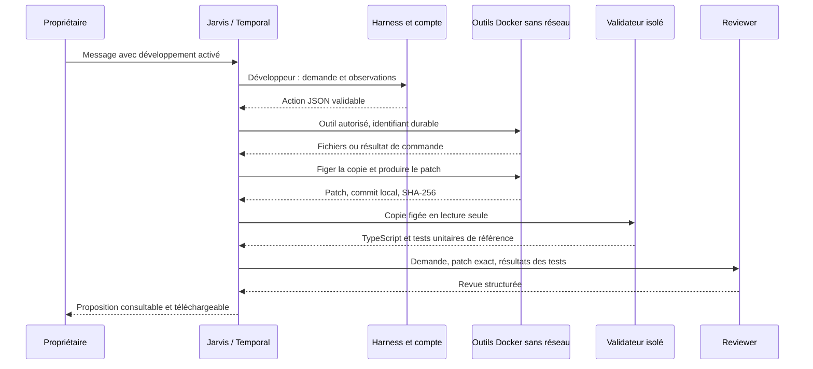

# Outils de développement — première tranche

Le propriétaire autorise les outils pour un message en cochant **Développer Jarvis**. Ce booléen est persisté avec la mission et intégré à l’idempotence de l’envoi. Une décision du modèle ne peut pas l’activer. Les conversations et délégations ordinaires restent sans outils.

## Exécution

- Image `jarvis-development:current`, construite explicitement avec le profil Compose `tools`. Son digest est figé à la création de chaque changement. Elle contient le code fourni au build, les dépendances du lockfile et Git/Node/npm. Le téléchargement de [GitHub CLI 2.83.2](https://github.com/cli/cli/releases/tag/v2.83.2) vérifie le SHA-256 publié avec cette version. Aucun outil de l’hôte n’est utilisé.
- Cible initiale : le code de Jarvis inclus dans cette image. Ce n’est pas un clone synchronisé automatiquement avec `origin/main`. Reconstruire l’image après une évolution du code de référence. Le commit Git de travail est local et synthétique ; il ne désigne pas un commit GitHub. Le digest d’image identifie la référence réellement utilisée.
- Copie par mission dans `jarvis-workspace-<uuid>`. Une branche `jarvis/<uuid>` est initialisée. Le service génère le patch depuis une copie Git propre ; il ne fait confiance ni aux hooks ni à l’index que le développeur aurait modifiés. Les liens symboliques/fichiers spéciaux sont refusés dans les fichiers exportés. Les répertoires générés et les fichiers `.env*` sont exclus.
- Une opération utilise un conteneur jetable identifié durablement : utilisateur 1000, réseau `none`, racine en lecture seule, capabilities supprimées, `no-new-privileges`, 1 CPU, 1 Go de RAM, 128 processus, espace temporaire borné. Aucune variable de compte, clé, volume de compte, socket Docker ou montage hôte. Le terminal ne peut donc pas utiliser le GitHub de l’hôte.
- Les conteneurs et leurs métadonnées persistent après exécution : même UUID et même empreinte d’entrée rendent le même résultat. Après un redémarrage du superviseur, il relit l’état et les logs Docker. Une annulation laisse un enregistrement durable et empêche un redémarrage ultérieur de l’opération. Au plus deux outils actifs sont lancés par superviseur.
- Les appels au modèle restent dans le conteneur du compte. Le développeur émet des actions `list/read/write/remove/exec/done`. Jarvis valide ces actions puis transmet seulement les arguments d’outil à la sandbox. Les outils natifs et sous-agents du harness restent désactivés. Les sorties du terminal sont des données, pas de nouvelles autorisations.

## Vérification et revue

Après `done`, une opération monte le volume de travail en lecture seule, crée un patch et une copie figée dans `jarvis-artifact-<uuid>`. Aucune opération du développeur ne monte ce second volume. Un nouveau conteneur monte l’artefact en lecture seule et vérifie une copie temporaire avec les dépendances de référence. Les liens des packages internes pointent vers le code candidat, pas vers la référence.

Le validateur restaure les tests unitaires et `tsconfig.json` depuis l’image approuvée, puis exécute des commandes fixes : TypeScript et les tests unitaires de référence. Les tests ajoutés par l’agent sont présents dans le patch et peuvent être lancés par son terminal, mais ne remplacent pas cette suite de référence. Le reviewer reçoit demande, patch intégral et rapport de tests, dans une session séparée sans les arguments du développeur, sans outil d’écriture. Un test en échec ne peut pas être rendu favorable par sa réponse. Une revue absente/invalide ou un patch trop long ne produit pas une proposition prête.

Le rapport et le patch sont conservés dans PostgreSQL et consultables après rechargement. Le téléchargement exige la session propriétaire. Les états distinguent développement, vérification, revue, proposition prête, corrections, échec des tests, interruption et annulation.

## Limites assumées

Cette tranche ne réalise ni commit/push vers GitHub, ni connexion `gh`, ni installation réseau, ni autre dépôt, ni navigateur automatisé dans la sandbox, ni publication. Elle ne donne pas au code généré un jeton de déploiement. Le test Chromium de l’interface Jarvis est effectué pendant la recette du logiciel, pas encore à la demande d’un agent.

Les vérifications couvrent la compilation et les tests unitaires de référence, pas une qualification complète de release. La revue demeure un avis de modèle. La protection contre une sandbox hostile repose sur l’isolation Docker ; ce n’est pas une micro-VM. Les ressources CPU/RAM/processus et la taille exportée sont bornées, mais le volume de travail n’a pas encore de quota disque global. L’usage est réservé à cette instance personnelle ; quota disque, purge automatique et isolation renforcée précèdent un usage multiutilisateur.

Les conteneurs arrêtés et les volumes de travail/artefact sont conservés. Pour une maintenance, identifier les objets avec les labels `jarvis.owner` et `jarvis.development`, ne nettoyer qu’une mission terminale et préserver les volumes de compte. Le nettoyage automatique avec rétention reste à livrer. Supprimer un journal d’opération encore actif casserait la garantie d’idempotence.

Bornes actuelles : 20 tours développeur, 32 appels modèle au total, 30 minutes de mission, 5 minutes par appel ; 90 secondes par commande, 4 minutes maximum par opération supervisée ; 3 000 fichiers et 32 Mo de code exporté, 2 Mo par fichier existant, écriture de 60 000 caractères, lecture par tranches de 16 000. Diff de 20 fichiers et 100 000 caractères maximum ; revue automatique jusqu’à 42 000 caractères de patch. Ces bornes ne sont pas un plafond de facturation fournisseur.
