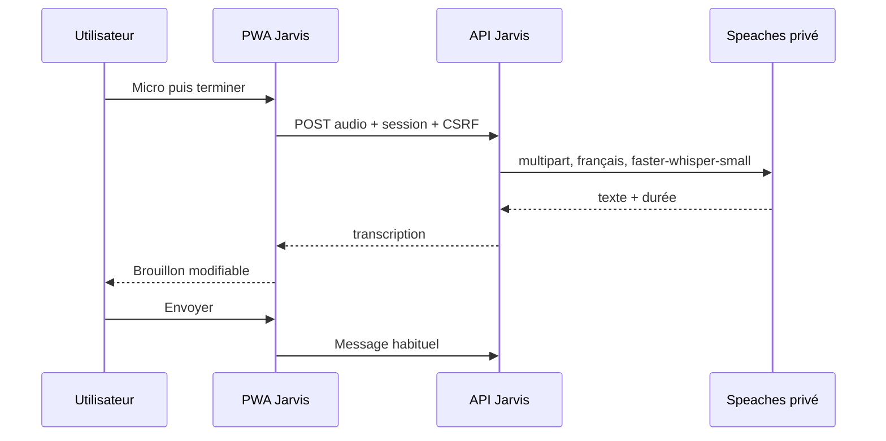

# Dictée vocale — Speaches / faster-whisper

## Choix et périmètre

Même technologie que `educ-backend-voice` : Speaches, faster-whisper, modèle
`Systran/faster-whisper-small`, CPU int8, français et détection de parole (VAD).
Un conteneur et un volume de modèles propres à Jarvis ; aucune dépendance au
service EducAI, aux comptes Codex/Claude ou à une API de transcription payante.
La synthèse vocale (TTS), le streaming et le mot de réveil restent hors périmètre.



## Interface

Le bouton microphone demande la permission uniquement au clic. MediaRecorder
choisit WebM/Opus ou MP4 (Safari), puis Ogg si disponible. Le compteur s'arrête
à 59 secondes pour garder une marge sous la limite serveur de 60 secondes.
Le résultat complète le brouillon ; rien n'est envoyé automatiquement à un agent.
La saisie et l'envoi sont suspendus pendant la capture et la transcription.
Une annulation, un changement de conversation/vue, une déconnexion, une perte de
réseau ou le passage en arrière-plan libère le micro et ignore les retours tardifs.
Un refus de permission, un format absent ou une erreur moteur laisse le chat texte
utilisable. L'interface indique le téléchargement/préchauffage du modèle.

Sur iPhone, accès HTTPS obligatoire, PWA au premier plan. `localhost` est accepté
sur ordinateur. Pas d'écoute permanente ni de microphone en arrière-plan.

## API

- `GET /api/v1/voice/status` → `state`: `disabled`, `preparing`, `ready`, `unavailable`.
- `POST /api/v1/voice/transcriptions` → `{ text, durationSec }`.
  Corps **audio binaire** (Content-Type `audio/webm`, `audio/ogg`, `audio/mp4`,
  `audio/wav`, `audio/x-wav` ou `video/webm`, avec éventuels codecs).
  Jarvis fabrique ensuite le multipart attendu par Speaches ; aucun parseur
  multipart supplémentaire n'est nécessaire côté Fastify.

Session propriétaire, origine et CSRF sont vérifiés **avant** lecture du corps.
Limites : 2 Mio, 60 s, 30 requêtes/minute, une inférence simultanée par processus
API, timeout d'inférence de 30 s. `verbose_json` permet de vérifier la durée
réelle renvoyée par le décodeur ; une réponse sans durée est refusée. La durée
est vérifiée après inférence, comme dans le service de référence : ce n'est pas
un quota de calcul avant décodage. Les limites mémoire/CPU conteneur et timeout
restent nécessaires. Annuler côté navigateur n'interrompt pas forcément le
calcul déjà lancé dans Speaches (borné côté requête).

Audio en mémoire, sans fichier permanent ni écriture en base. Le temporaire du
moteur est sur tmpfs. Les journaux ne contiennent ni audio ni texte ; désactiver
le niveau debug Speaches. Le texte devient le brouillon habituel (stockage local
existant), puis un message persistant uniquement à l'envoi.

## Exploitation

Le profil Compose `app` inclut `whisper` sans port publié. Image CPU figée par
digest ; mise à jour explicite après validation. Volume `whisper-models` dédié
au cache Hugging Face, conservé entre redémarrages. Prévoir environ 0,5 Go pour
le modèle, plus l'image, jusqu'à 3 Go de RAM et 4 CPU (limites configurables dans
Compose). Aucun GPU requis. Le premier lancement télécharge le modèle sur
Hugging Face puis transcrit un silence pour préchauffer ; le chat reste utilisable.
Le téléchargement a un délai de 5 minutes. En cas d'échec, la consultation du
statut retente après 30 secondes. Une fois installé, aucun fournisseur distant
n'est appelé pour transcrire. L'absence du moteur ne dégrade pas `/healthz` du chat.

`WHISPER_URL` configure l'URL privée et `STT_MODEL` le modèle. Sans `WHISPER_URL`,
la dictée est désactivée (utile pour tests et développement sans modèle).

Pour une API lancée avec `npm run dev` :

```bash
docker compose -f docker-compose.yml -f infra/voice.dev.yml --profile voice up -d whisper
# Dans .env : WHISPER_URL=http://127.0.0.1:8000
npm run dev
```

Le fichier de développement publie seulement sur loopback. Ne pas l'utiliser
pour exposer Speaches sur Internet.

### Compatibilité Docker ancien

L'hôte de validation utilise Docker 20.10.8 et un ancien runc. L'image Ubuntu
récente appelle `clone3` pour les threads : le profil par défaut retourne EPERM
au lieu du ENOSYS attendu par la libc, et runc ne sait pas appliquer le retour
errno personnalisé. `infra/speaches-seccomp.json` reprend le profil officiel
Moby v20.10.8 en ajoutant uniquement l'autorisation `clone3`. Ce syscall accepte
des flags par pointeur et n'est donc pas filtrable comme `clone` : cette extension
est limitée au moteur STT, sans exécution d'outils ou de code fourni par les agents,
sans capacités Linux, avec `no-new-privileges`. Les autres conteneurs ne changent
pas. Sur Docker récent, préférer le profil Docker par défaut après vérification.

Source du profil (licence Apache-2.0) :
https://github.com/moby/moby/blob/v20.10.8/profiles/seccomp/default.json

## Vérifications

Tests unitaires : format multipart, modèle/langue/VAD, MP4, limites, erreurs
masquées, durée manquante, timeout, silence et concurrence.
Tests d'intégration : session/origine/CSRF, binaire, réponse, taille, format.
Tests navigateur : dictée, relecture sans envoi, annulation, refus micro,
erreur serveur, conversation changée, écran mobile et absence de débordement.
Un test audio synthétique réel valide le moteur ; une validation sur iPhone
physique reste nécessaire pour le microphone matériel et les interruptions iOS.

Références : [installation Speaches](https://speaches.ai/installation/),
[API STT](https://speaches.ai/usage/speech-to-text/),
`educ-backend-voice/src/transcription/transcription.service.ts` (référence locale).

Validation locale : 16 tests unitaires, 37 tests d'intégration et 6 parcours
Playwright (desktop et mobile émulé) passent. Échantillon français synthétique
transcrit via WAV puis via MediaRecorder WebM réel dans Chrome : retour au
brouillon, sans appel de harness. Le nom propre Jarvis est imparfaitement reconnu
sur la voix synthétique ; ce test valide le transport et l'inférence, pas la
qualité sur toutes les voix. La relecture reste disponible avant envoi.
