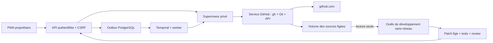

# GitHub : source figée et pull requests

## Parcours livré

1. Réglages → GitHub → **Se connecter à GitHub dans le navigateur**.
2. Ouvrir `https://github.com/login/device`, saisir le code affiché et autoriser
   GitHub CLI. La page détecte la connexion. Aucun compte de l'hôte n'est importé.
3. Vérifier/enregistrer `rl-safeyes/jarvis` et la branche `main` (ou le dépôt
   explicitement choisi par le propriétaire). Le compte doit pouvoir y écrire.
4. Cocher **Développer Jarvis pour ce message** et lancer une nouvelle mission.
   La branche distante est résolue en commit et copiée avant le premier outil.
5. Après fin de mission, tests réussis et revue favorable, le bouton **Créer une
   pull request en brouillon** autorise explicitement la publication du patch.
6. Jarvis crée une branche `jarvis/<change-id>`, un commit et une PR en brouillon.
   Le lien et l'état persistent après rechargement/redémarrage.

Une proposition antérieure, construite depuis l'image locale sans source GitHub,
reste téléchargeable mais ne peut pas être publiée par ce parcours. Une nouvelle
mission est nécessaire. Aucun merge ni déploiement n'est implémenté ici.

## Isolation



Le service `github` est un conteneur dédié, sans socket Docker, sans port publié,
non root, racine en lecture seule, capacités supprimées. Il reçoit seulement le
jeton de service interne. Les agents ne peuvent pas appeler ses opérations ni
lire son volume privé. `github-state` contient le cache natif GitHub CLI, les
clones bare et le journal des publications. Comme les caches natifs des harnesses,
la connexion doit être protégée avec le volume et les sauvegardes ; le fichier
natif `gh` n'est pas chiffré par un trousseau dans ce conteneur headless.

Le parcours `gh auth login --web --hostname github.com --git-protocol https`
utilise les autorisations OAuth officielles de GitHub CLI (qui peuvent couvrir
plusieurs dépôts du compte). L'API Jarvis limite le parcours au dépôt enregistré
par le propriétaire. L'organisation peut exiger une autorisation SSO. Le code
est temporaire ; annuler tue le processus, déconnecter efface le cache du compte
propre à Jarvis. Le jeton natif n'est jamais renvoyé à la PWA, aux modèles ou aux
outils de développement, ni placé dans une URL Git.

Le volume `${JARVIS_RUNTIME_PREFIX}-github-sources` est partagé en lecture seule
avec les outils. Il ne contient que le code et les métadonnées des snapshots,
jamais la connexion GitHub. Les snapshots précédents restent lisibles dans ce
volume sur cette instance personnelle ; il ne constitue pas une isolation entre
plusieurs propriétaires/dépôts sensibles. Le préfixe doit être unique par instance.

## Source et validation

Chaque changement conserve `{ repository, branch, commit, snapshot_id,
manifest_digest }`. Le worker fige le dépôt/branche lors de la création du
changement ; une modification des réglages concerne les missions suivantes.
Le snapshot est conservé entre reprises ; la branche distante n'est pas suivie
en cours de mission. Clone HTTPS peu profond, hooks/credentials/config Git de
l'hôte désactivés, extraction des blobs sans checkout exécutable.

Limites : 3 000 fichiers, 32 Mio de code, 2 Mio par fichier ; liens symboliques et
sous-modules refusés. Exclusion des `.git`, `.env*`, dépendances et sorties de build.
Ces exclusions ne permettent pas d'effacer ces fichiers distants : la publication
ne remplace que les fichiers présents dans le patch, sur l'arbre Git d'origine.

L'image de développement reste la référence des dépendances et des vérifications
indépendantes. Le lockfile distant doit correspondre exactement au lockfile de
l'image ; sinon la mission s'arrête avec une explication. Les sources récentes
peuvent aussi exiger une nouvelle image pour que la suite de référence soit
compatible. Après mise à jour du logiciel, publier le code sur la branche choisie
et reconstruire l'image avec `docker compose --profile tools build development-image`.
La connexion GitHub n'envoie pas les commits locaux non poussés.

Le validateur restaure les tests unitaires de référence (`.test.ts` et `.test.mjs`)
et la configuration TypeScript. Une image approuvée reste nécessaire ; importer
un autre projet aux dépendances arbitraires n'est pas pris en charge par ce lot.

## Publication durable

L'API propriétaire accepte seulement l'identifiant du changement et le SHA-256
du patch consulté. Elle vérifie fin de mission, état proposé, succès des tests,
review favorable, source GitHub, digest recalculé et dépôt actuellement configuré.
Une transaction enregistre `github_publications` et une opération `github_publish`
dans l'outbox existante. Les requêtes simultanées retournent la même publication.

Le worker Temporal transmet le payload figé au service GitHub. Ce service :

- reprend le snapshot source, vérifie/applique le patch avec Git sans exécuter le code ;
- refuse secrets, chemins invalides, liens, sous-modules et modifications `.github/`,
  `.gitattributes`, `.gitmodules` (procédure dédiée encore à livrer) ;
- crée les blobs/arbre/commit via l'API GitHub, avec le commit source comme parent ;
- utilise l'arbre distant de base afin de préserver les fichiers non modifiés ;
- vérifie la tête de la branche de départ avant publication ; une évolution exige
  une nouvelle mission, sans rebase automatique sur des tests périmés ;
- crée uniquement une nouvelle référence de branche, jamais un force-push ;
- crée une PR en brouillon et journalise le lien.

Le commit a une identité/date/message figés et la branche est déterministe. Une
réponse perdue est réconciliée par référence et PR existantes avant toute reprise.
Une branche préexistante de contenu différent provoque un conflit. Une PR déjà
fermée est retrouvée, pas recréée. Les états GitHub peuvent évoluer après la
publication : le lien conservé n'atteste pas que les contrôles restent valides.

En cas d'interruption, **Réessayer ou retrouver la PR** reprend le même patch avec
une nouvelle opération Temporal. Une branche ou un commit peuvent subsister si
la création de PR échoue. Aucune suppression automatique de branche n'est faite.
Un changement de base au dernier instant n'est pas verrouillable avec ces appels
GitHub ; le commit reste attaché à la base figée, la PR reste en brouillon et
aucune fusion automatique n'est autorisée.

## API

- `GET /api/v1/github` : connexion et réglages.
- `POST /api/v1/github/connect`, `/disconnect` : parcours propriétaire.
- `POST /api/v1/github/repository` : `{repository, branch, revision}`.
- `GET /api/v1/development/:id/github` : état et lien de publication.
- `POST /api/v1/development/:id/github` : `{digest}` ; création/reprise idempotente.

Le bridge interne ne reçoit que les actions connues via `/request`, protégé par
le jeton interne. Aucune commande arbitraire n'est exposée.

## Déploiement et conservation

```bash
docker compose --profile app build github supervisor app worker
docker compose --profile tools build development-image
# Après la fin des missions en cours :
docker compose --profile app up -d github supervisor app worker
```

Migration additive `005-github` : réglages, publication, source des changements
et nouveau type d'outbox. Préserver les volumes existants et les nouveaux volumes
`github-state`/`github-sources`. Les historiques de clones/snapshots ne sont pas
encore purgés automatiquement : la rétention et les quotas disque restent un lot
à implémenter. Le moteur STT et les comptes de harness ne sont pas remplacés.

## Recette et limites

Tests avec Git réel local et API GitHub simulée : extraction, patch, contenu,
parent du commit, branche/PR uniques, réponse perdue, restart, digest, conflit de
base, chemins protégés et déconnexion. PostgreSQL : session/CSRF, critères de
publication, concurrence, réglages versionnés, outbox et reprise du worker.
Playwright : connexion guidée et PR persistante, ordinateur/mobile. CLI réelle :
code appareil officiel obtenu puis annulé dans un compte vide.

La création d'une PR sur le compte réel demande que le propriétaire termine la
connexion. Aucun jeton hôte n'est réutilisé pour transformer un test en publication
réelle. Les contrôles de préproduction, classement de risque, merge, déploiement
et rollback restent à construire.

Sources : [GitHub CLI auth login](https://cli.github.com/manual/gh_auth_login),
[Git trees](https://docs.github.com/en/rest/git/trees),
[Pull requests](https://docs.github.com/en/rest/pulls/pulls).
