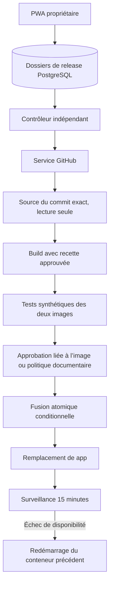

# Fusion, déploiement et retour arrière

## Périmètre livré

Ce lot rend les propositions de documentation et d’interface déployables depuis
Jarvis. Le contrôleur ne remplace que le service `app`. Le worker Temporal,
PostgreSQL, GitHub, les comptes de harness, le STT et le contrôleur restent actifs.
Une release ne change ni schéma, ni backend, ni dépendance, ni configuration Docker.
Les autres changements exigent une procédure opérateur distincte ; une approbation
ne peut pas élargir ce périmètre.

Le parcours manuel est : PR → préproduction → **Préparer la fusion et le
déploiement** → image construite/testée et ancienne image testée → **Approuver la
fusion et le déploiement** → fusion conditionnelle → remplacement → surveillance.
L’approbation lie le commit, l’image Docker immuable, la politique et la révision
du dossier. Elle n’autorise pas une nouvelle version arrivée ensuite.

Le réglage **Activer les releases automatiques de documentation** autorise ce
parcours pour les petites modifications documentaires classées faibles, après
publication d’une PR et contrôles réussis. Le réglage est désactivé à l’installation,
lié au digest de politique et devient inapplicable après changement du validateur.
Les modifications d’interface demandent toujours l’approbation de l’image préparée.
La désactivation bloque les prochaines préparations/approbations automatiques ;
elle n’annule pas une fusion déjà commencée. La publication initiale de la PR
conserve son autorisation explicite dans l’interface.

## Architecture



`release-controller` a un socket Docker et un accès PostgreSQL. C’est un composant
privilégié, distinct des agents, sans port HTTP publié. Il ne charge pas de code
du candidat pour piloter Docker. Le service GitHub exporte les blobs d’un commit
qualifié dans un volume de sources sans cache de connexion. Le contrôleur utilise
sa recette Dockerfile approuvée, construit une image puis la référence par son ID.
Les identifiants de production ne sont pas injectés dans le build ou les tests.

Un verrou PostgreSQL de session élit un seul contrôleur. Une contrainte unique
interdit deux releases actives. `deployments` conserve chaque intention et ses
étapes ; `release_settings` contient autonomie, maintenance et présence du contrôleur.
L’arrêt du contrôleur ne supprime ni les images ni le conteneur précédent.

## Vérifications avant effets

Les preuves GitHub et le digest de politique sont revérifiés avant préparation et
fusion. Le contrôleur et le bridge doivent exécuter la même politique. Le contenu
de tous les fichiers de contrôle doit correspondre à la version installée.

Le diff entre le commit réellement déployé et le candidat doit lui aussi rester
limité à la documentation/interface. Cette comparaison cumulée permet une correction
après rollback, lorsque GitHub contient encore le changement retiré de production.
Un historique divergent, un nouveau backend ou une migration bloque la release.

Au moins 2 Gio libres sont requis sur le volume d’état Docker avant préparation.
Cette réserve est un seuil de refus, pas un quota ou une garantie de place pour
un nombre illimité de versions. Les images de release et anciens conteneurs ne sont
pas purgés automatiquement dans ce lot ; l’opérateur doit gérer leur rétention.
Ne jamais purger l’image/le conteneur référencé comme version actuelle ou précédente.

## Fusion

Le bridge utilise la mutation officielle GitHub `updateRefs` avec `beforeOid`,
`afterOid` et `force:false`. La référence de base doit être au commit source exact,
et la branche de PR doit toujours être au commit approuvé. Les deux contrôles sont
atomiques. C’est une avance rapide : aucune réécriture, aucun commit de merge
supplémentaire, le code fusionné reste le commit testé. La PR est d’abord rendue
prête ; GitHub peut la marquer fusionnée indirectement une fois son commit intégré.

Une branche déclarée protégée ou couverte par des règles GitHub est refusée dans
ce parcours, même si le compte pourrait les contourner. Il faut alors une procédure
compatible avec ces règles. Le système ne désactive ni protections, ni règles.

Le journal GitHub est écrit avant la mutation. Après réponse perdue, le contrôleur
reconnaît le commit déjà intégré avant de réessayer. Une ambiguïté persistante reste
visible sous « fusion à réconcilier », sans déploiement spéculatif. La commande de
reprise conserve la même intention. Une PR peut rester prête si la fusion échoue.

## Remplacement et restauration

L’image candidate est testée sur base synthétique. L’ancienne image passe aussi les
sondes synthétiques avant approbation. La mécanique de remplacement/restauration
est qualifiée par une fixture Docker dédiée, y compris interruption et image cassée.
Ces tests ne sont pas une restauration des données de production.

Le service `app` doit être issu de la composition configurée, porter le label OCI
`org.opencontainers.image.revision` avec le commit exact, avoir une racine en lecture
seule, aucun montage de données et un seul réseau. Les installations antérieures
sans label demandent une mise à jour opérateur initiale. L’image et le conteneur de
référence sont capturés avant construction ; un changement opérateur concurrent
annule la bascule.

Le contrôleur active une courte maintenance des écritures, arrête/renomme l’ancien
conteneur et démarre le nouveau avec les mêmes paramètres d’application et ports.
L’ancien conteneur est conservé arrêté avec sa configuration. Les secrets ne sont
pas enregistrés dans le dossier de release : ils restent dans la configuration
Docker protégée. Une interruption HTTP/SSE brève est possible. Les missions en
cours continuent dans le worker non remplacé.

Après bascule : contrôle HTTP/PWA, connexion et lecture des conversations, puis
contrôles HTTP de disponibilité toutes les cinq secondes pendant quinze minutes.
Les erreurs de ces sondes provoquent un rollback. Ce monitoring ne détecte pas
toutes les erreurs fonctionnelles du JavaScript ou des modèles ; les tests CI et
la review restent nécessaires. Le bouton **Restaurer la version précédente** reste
accessible après surveillance. Aucun compte de modèle n’est consommé par ces sondes.

Un rollback redémarre le conteneur précédent et remet son image sous le tag local
`<projet>_app:latest`. Il conserve les conversations et ne réinitialise pas la base.
Il ne réécrit pas GitHub : une nouvelle proposition doit corriger le code fusionné.
Si la restauration échoue, le dossier reste actif en `rollback_failed`, maintenance
conservée, avec possibilité de relance et intervention opérateur. Aucun autre
conteneur inconnu n’est détruit pour libérer le nom.

## Installation opérateur de ce lot

Après sauvegarde et fin des missions en cours :

```bash
# Fixer JARVIS_SOURCE_COMMIT au git rev-parse HEAD de la version approuvée.
# Ne jamais étiqueter une image modifiée avec le commit d’une autre version.
docker compose --profile app build github supervisor app worker release-controller
docker compose --profile tools build development-image
docker compose --profile app up -d github supervisor app worker release-controller
```

`JARVIS_SOURCE_COMMIT` est un argument de build/label, pas un secret.
`COMPOSE_PROJECT_NAME` doit correspondre au projet Docker ciblé (par défaut `jarvis`).
Préserver les volumes et les paramètres existants. Après une release, reconstruire
manuellement depuis un ancien checkout peut réinstaller une ancienne version :
mettre à jour le checkout et son label avant toute intervention opérateur.

## API

- `GET /release-settings`, `POST /release-settings` : état et autonomie documentaire.
- `GET /release-policy` : digest installé à approuver.
- `GET|POST /development/:id/deployment` : dernier dossier/préparation.
- `POST /deployments/:id/action` : `approve`, `cancel`, `rollback`, `reconcile`, avec
  révision, commit, image et digest de politique obligatoires.

Préfixe commun `/api/v1`. Session propriétaire et CSRF requis pour toute mutation.
Les agents n’ont pas de route d’approbation ni de socket Docker.

## Validation et limites

Tests unitaires : autorisations, état durable, perte de réponse, protection de
branche, comparaison atomique des deux références, rollback et perte du verrou.
Tests PostgreSQL : préparation concurrente unique, approbation périmée refusée,
liaison à l’image, CSRF, maintenance et réglage versionné. Tests navigateur :
approbation explicite et restauration sur ordinateur/mobile. Fixture Docker réelle :
port conservé, reprise après arrêt/renommage, absence de doublon et image cassée.

La mutation GitHub réelle et une release autonome sur le compte propriétaire ne
sont pas exécutées par les tests : elles demandent une proposition éligible et
l’autorisation dans Jarvis. Les tests utilisent des réponses GitHub contrôlées.
Restent hors périmètre : backend/migrations, déploiement du contrôleur lui-même,
releases multi-services, registre distant d’images, canari et bascule sans interruption,
purge/quotas complets et évaluation fonctionnelle exhaustive après déploiement.

Sources officielles : [updateRefs et comparaison atomique](https://docs.github.com/en/graphql/reference/git),
[fusions indirectes](https://docs.github.com/en/pull-requests/reference/pull-request-merges).
